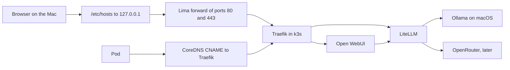

# Architecture

Status: accepted. Implement one step at a time from `PLAN.md`.

This repo is the infrastructure. Host agents, the Colima profile, Kubernetes manifests, DNS, and TLS all live here. A script only copies those files into place. Secrets stay in an uncommitted `.env`.

## What is already on the machine

- Apple Silicon Mac, 64 GB RAM, about 780 GB free
- Ollama 0.40.13, started by hand in a terminal (`ollama serve`), listening on `127.0.0.1:11434`
- One model: `qwen3.8:27b-mlx` (18 GB, MLX, tools / vision / thinking)
- Colima 0.10.3 installed, no VM running
- kubectl 1.37.2 installed
- Helm is not installed
- Docker CLI is installed, Docker Desktop is not running

## Decisions

**Ollama stays on macOS, outside Kubernetes.** The model runner is MLX, so it uses the Apple GPU. Colima is a Linux VM and has no Metal. A GGUF model pulled later stays on the host for the same reason. The cluster calls the host. It does not run the model.

You start and stop it from this repo (`make ollama-start`, `make ollama-stop`, `make ollama-status`). A LaunchAgent starts it at login with no terminal window. `make ollama-disable` turns that login start off, and `make ollama-enable` turns it back on. `make ollama-stop` stops the process until the next start or the next login.

**Kubernetes is Colima's built-in k3s.** Colima 0.10 already has this (`colima start --kubernetes`). There is no second k3s install, no k3d, and no Docker Desktop. The profile name is `ai`, so a later Docker-only VM can still use the `default` profile. Colima writes that profile into `~/.kube/config` as `colima-ai`. The start script renames the cluster, user, and context to `local`, which is the name Lens uses.

**The VM is Colima on Apple's `vz` engine.** 4 CPUs, 25 GiB RAM, 100 GiB root disk, 160 GiB data disk, `virtiofs`. Those 25 GiB stay reserved on the Mac while the VM is running, including when the cluster is idle. krunkit can return unused RAM, but on Colima 0.10 its data disk can fail to mount after a restart, so images and cluster data fall onto the root disk. That is a bad trade for a cluster that starts every day. krunkit is a Colima engine, not a substitute for Colima, and it does not move Qwen onto the GPU.

A large test raises the reservation with a restart (`make cluster-memory MEMORY=30`), then returns it to 25 GiB. About 30 GiB is the top end while Qwen is loaded. The memory size can change across a restart. The VM type cannot. No Mac-local Kubernetes grows past its boot-time size while the cluster is still running.

Qwen stays outside the VM (~18 GB when loaded). Kubernetes ephemeral storage is the VM root disk, 100 GiB (`rootDisk` in `colima/ai.yaml`). Colima’s separate data disk is 160 GiB. Image layers live on that disk. Both can only grow, and the image files fill as data is written.

**LiteLLM is the only model API.** Chat, downloaded agents, and a future OpenRouter model all use one OpenAI-compatible URL and stable names:

| Name you request | Where it goes |
| --- | --- |
| `local` | Host Ollama, model `qwen3.8:27b-mlx` |
| `strong` | OpenRouter, added only after an API key exists |

Changing the local model means editing that one alias and reapplying. Agents keep asking for `local`. Open WebUI is pointed at LiteLLM only, so the same model is not listed twice.

LiteLLM speaks Ollama's chat API (`ollama_chat/...`), which is the path that supports tools. Thinking text from Qwen may look plainer in the UI than in the `ollama` terminal. Step 8 of the plan checks that. If it is a bad chat experience, Open WebUI can gain a direct Ollama connection without removing LiteLLM.

**Open WebUI is the chat product.** It keeps separate chats, users, and its own RAG (Knowledge). Community tools are installed from the Open WebUI catalog in the UI. That is the "download an agent" path. This repo does not grow a Python agent framework.

A heavier downloaded app (another service with its own UI) is a later Deployment plus an Ingress hostname. It receives:

- `OPENAI_BASE_URL=http://litellm.ai.svc.cluster.local:4000/v1`
- `OPENAI_API_KEY` from the LiteLLM master key
- `OPENAI_MODEL=local` or `strong`

**Workloads are plain Kubernetes manifests**, built with kustomize (already inside kubectl). Helm is not added for two Deployments. Traefik itself is the chart k3s ships; we only add a `HelmChartConfig` for it.

**Hostnames are names under `.test`, with no port in the URL.** `.test` is a reserved TLD (RFC 2606). `.local` stays with Bonjour: macOS resolves that zone through mDNS, so a `.local` name is slow and can collide with AirPlay and other Macs.

The Mac and the cluster resolve these names differently.

On the Mac, `/etc/hosts` maps each public name to `127.0.0.1`. The block is marked `# aihub-local begin` and `# aihub-local end`. It is a list. A new browser name is another word on those lines, then a new Ingress. `chat.test` and `llm.test` are the names planned for Open WebUI and LiteLLM. They join that list when those Ingresses exist.

Inside the cluster, CoreDNS answers every `*.test` name. Pods do not read `/etc/hosts`. A pod that calls another pod directly still uses the Kubernetes service name.

| Who is calling | Address |
| --- | --- |
| You, in a browser, for a name listed in `/etc/hosts` | `https://aihub.test`, and later `https://chat.test` |
| You, or a Mac app, calling the proxy, once `llm.test` is listed | `https://llm.test/v1` |
| A pod calling any `*.test` name | `https://auth.aihub.test` and the rest, via CoreDNS |
| A pod calling the proxy before that Ingress exists | `http://litellm.ai.svc.cluster.local:4000/v1` |
| LiteLLM calling Ollama | `http://192.168.5.2:11434` |

`192.168.5.2` is the Colima gateway: the Mac as seen from the VM. It is pinned in the Colima profile. Ollama does not get a public name. It has no authentication, so it is not put on an Ingress.

## How a request moves



From the Mac:

1. `/etc/hosts` answers the listed names with `127.0.0.1`.
2. Colima's Lima forward publishes guest TCP ports 1–65535 on the Mac, so `127.0.0.1:80` and `:443` reach the VM. Traefik is the process behind those ports. The Host header selects the Ingress.
3. Nothing else is installed for this path. There is no dnsmasq, no `/etc/resolver/test`, and no pf anchor.

From a pod:

1. `deploy/system/coredns-custom.yaml` is the only `test:53` server block. k3s loads it from ConfigMap `kube-system/coredns-custom` at `/etc/coredns/custom/*.server`.
2. An A query receives a CNAME to `traefik.kube-system.svc.cluster.local`. The address follows the Service, so the ClusterIP is not copied into the file. An AAAA query receives NOERROR and no record, so the client keeps the A answer.
3. A second `test:53` block makes CoreDNS reject its config and crash-loop. A rewrite that uses `answer name` does the same. `make dns-install` applies this file and restarts CoreDNS.

## Certificates

One CA signs every `.test` certificate. It lives on the Mac in `~/.local-ca/` (`ca.crt` and `ca.key`, directory mode `0700`, key mode `0600`). The key is not in git.

The certificate is ECDSA P-256, subject `CN=Local .test CA`, valid for about ten years. The extensions are critical: basic constraints `CA:TRUE`, key usage certificate sign and CRL sign, and a name constraint permitting DNS `test`. That constraint allows names such as `aihub.test` and `api.aihub.test`, and no other tree.

The login keychain trusts `~/.local-ca/ca.crt`. One root is enough. ClusterIssuer `local-ca` reads Secret `cert-manager/local-ca`, which is the same key pair (`tls.crt` and `tls.key`) in the `cert-manager` namespace. An Ingress asks for a certificate with `cert-manager.io/cluster-issuer: local-ca`.

A pod that calls `https://…test` trusts the public file only. Its namespace gets a ConfigMap built with `--from-file=ca.crt=$HOME/.local-ca/ca.crt`. Secret `cert-manager/local-ca` also holds the private key, so it stays in `cert-manager` and is never copied into an application namespace.

Writing the hosts block needs sudo once. Trusting the CA asks for approval in the login keychain once. Both survive a reboot. A new cluster needs the Secret, the ClusterIssuer, and `make dns-install` again. The files in `~/.local-ca/` stay where they are.

## What runs where

| Piece | Where | When it starts |
| --- | --- | --- |
| Ollama | macOS LaunchAgent from this repo | At login |
| `/etc/hosts` names and the trusted CA | macOS | Already present; they survive reboot |
| CoreDNS `test:53` block | ConfigMap `kube-system/coredns-custom` | With the cluster, after `make dns-install` |
| Colima VM and k3s | Profile `ai` | At login, after the manual bring-up works |
| Traefik, LiteLLM, Open WebUI | k3s | With the VM |
| Chats, uploads, installed tools | `~/.local-ai/open-webui` on the Mac, mounted into the pod | With Open WebUI |

Ollama environment in the agent:

- `OLLAMA_HOST=127.0.0.1:11434` in step 1, the same bind as today. Step 5 moves it to `0.0.0.0:11434` so the VM can connect.
- `OLLAMA_KEEP_ALIVE=-1` so the model stays resident until the agent stops.
- `OLLAMA_MAX_LOADED_MODELS=1`
- `OLLAMA_CONTEXT_LENGTH=32768`
- Flash attention and `q8_0` KV cache are set for a future GGUF model. MLX may ignore them.

Homebrew's Ollama service plist is not used. `brew upgrade ollama` rewrites it, and it does not carry these variables.

`brew services start ollama` must not be run beside this agent. Two servers cannot bind `11434`.

After sleep, Metal can drop the weights. The next request loads them again. Keep-alive does not survive a reboot of the Ollama process; the login agent starts the process, and the first request loads the model.

## Data and secrets

- Open WebUI's directory is a `hostPath` at `/Users/denis/.local-ai/open-webui`. Colima mounts your home directory into the VM, so this path is the same on both sides. `colima stop` keeps the chats. `colima delete` removes the VM and keeps this directory.
- LiteLLM is stateless. Its config is a ConfigMap.
- `.env` holds `LITELLM_MASTER_KEY`, `WEBUI_SECRET_KEY`, and later `OPENROUTER_API_KEY`. It is gitignored. `.env.example` is committed with empty secrets.
- Image tags are pinned: `ghcr.io/open-webui/open-webui:v0.12.5` and `ghcr.io/berriai/litellm:v1.106.6`. Both publish arm64.

## Memory budget

| Consumer | Rough size |
| --- | --- |
| Qwen weights | 18 GB |
| KV cache at 32k context | several GB more, depends on the chat |
| Colima VM, reserved while it is running | 25 GB normally, up to about 30 GB for a large test |
| macOS and apps | the rest of 64 GB |

One loaded model is the cap until you raise `OLLAMA_MAX_LOADED_MODELS` and accept the RAM.

## Repo shape, after implementation

Not created yet. This is the layout the plan fills in.

```text
ARCHITECTURE.md
PLAN.md
.env.example
.gitignore
Makefile
colima/ai.yaml
host/launchagents/com.local-ai.ollama.plist
host/launchagents/com.local-ai.stack.plist
deploy/kustomization.yaml
deploy/system/coredns-custom.yaml
deploy/system/traefik.yaml
deploy/ai/namespace.yaml
deploy/ai/litellm/
deploy/ai/open-webui/
deploy/ai/ingress.yaml
deploy/overlays/openrouter/
deploy/agents/example/
scripts/
```

`deploy/agents/example/` is not applied. It shows the env vars and the Ingress host for a later app.

## Accepted

1. Hostnames are `https://chat.test` and `https://llm.test/v1`.
2. Open WebUI talks only to LiteLLM, unless step 8 shows that Qwen thinking is too poor.
3. Ollama has no public hostname and is not put on an Ingress.
4. VM size 4 CPU / 25 GiB RAM on `vz` / 100 GiB root disk / 160 GiB data disk. A large test may raise RAM for one restart, then put it back.
5. First agents are Open WebUI Knowledge and catalog tools. A separate downloaded app waits until you name it.
